# Nudge AI

A native iOS app that removes the friction between having a thought worth
remembering and actually capturing it.

Capture is zero-structure and hands-free, through Siri or in the app. Classification
happens afterward and asynchronously: an LLM provider you choose (DeepSeek or
Anthropic) assigns a bucket, urgency and deadline. With no provider connected, you
sort items by hand at review. A nightly review turns captures into reminders, and
long-horizon items escalate over months.

## Principles

- **Capture never asks a question.** The Siri path logs raw text and nothing else.
- **Local first.** Every capture is timestamped and stored on-device (SwiftData) before any network call.
- **Bring your own AI, or none.** The app is fully usable with no provider connected.
- **No backend.** The app talks directly to your chosen platform with your own API key over HTTPS. There is no Nudge server.
- **Keys stay in the Keychain.** One API key per platform, plus the Apple user identifier. Disconnecting deletes the key.
- **Local notifications only.** No push server, and no notification when there is nothing to review.

## Tech

| | |
|---|---|
| Language / UI | Swift, SwiftUI |
| Persistence | SwiftData (offline-first) |
| Voice | App Intents (custom Siri phrase), Speech framework (on-device) |
| Notifications | UNUserNotificationCenter (local) |
| Identity | Sign in with Apple, local identity only |
| LLM | One provider-neutral protocol, URLSession adapters for Anthropic and DeepSeek, no SDKs |
| Target | iOS 17+, no third-party dependencies |

## Project layout

```
NudgeAI/
├── App/             entry point, App Intents, tab host, Today
├── Onboarding/      welcome, Sign in with Apple, choose AI platform, Siri, permissions
├── Capture/         Siri intent, in-app capture, speech-to-text
├── Classification/  provider-neutral client, adapters, prompts, JSON contract
├── Review/          nightly review card stack, Adjust (manual sort)
├── Reminders/       long-horizon escalation, detail screen
├── Notifications/   scheduling, quiet hours, copy
├── Persistence/     SwiftData models, repositories, migrations
├── Settings/        platform picker, Keychain key entry, model and timing config
└── Profile/         stats, Apple identity
NudgeAITests/        unit tests
```

## Build

The Xcode project is generated from `project.yml` with [XcodeGen](https://github.com/yonaskolb/XcodeGen):

```sh
brew install xcodegen
xcodegen generate
open NudgeAI.xcodeproj
```

Run the tests from Xcode, or:

```sh
xcodebuild -project NudgeAI.xcodeproj -scheme NudgeAI \
  -destination 'platform=iOS Simulator,name=<an installed iPhone>' test CODE_SIGNING_ALLOWED=NO
```

## Status

Phases 0 to 6 (capture, classification, review, long-horizon, onboarding, settings, profile) are
done. Phase 7 (multi-provider LLM, manual sorting with a real Adjust flow, Sign in with Apple)
is implemented and security-reviewed on `phase-7-multi-provider`. See
[`References/TASKS.md`](References/TASKS.md) for task-level status.

## Design

The source of truth is the
[Figma file](https://www.figma.com/design/oB82tlQm7eyDgsMdIuHKjx/Nudge-AI-%E2%80%94-iOS-Designs).
The screens below are the original 16-screen design pass. They predate Phase 7, so the
"Connect Claude" and "Claude and privacy" screens are now a platform picker (DeepSeek or
Anthropic) in the app, and onboarding has a Sign in with Apple step.

| | | | |
|---|---|---|---|
| 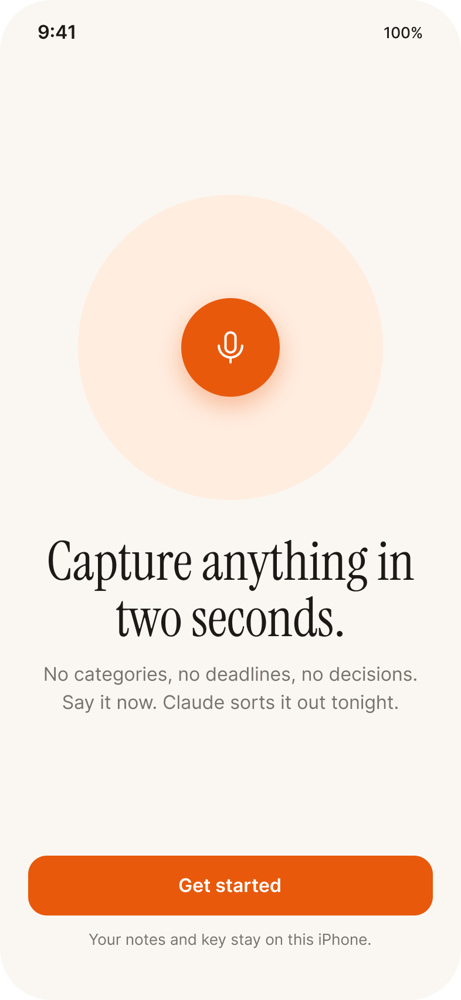<br>Welcome | 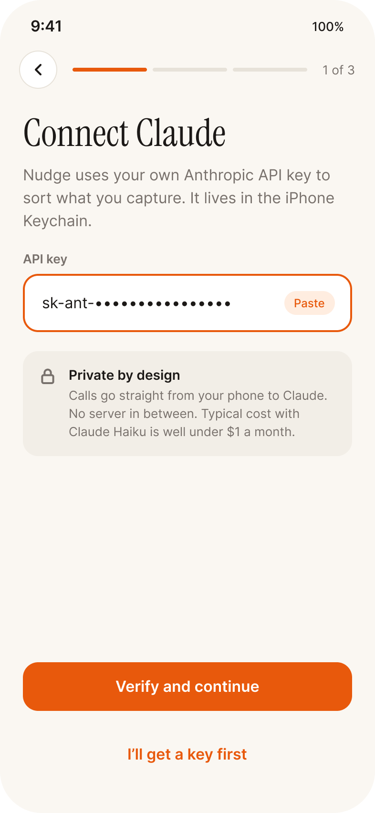<br>Connect AI platform | 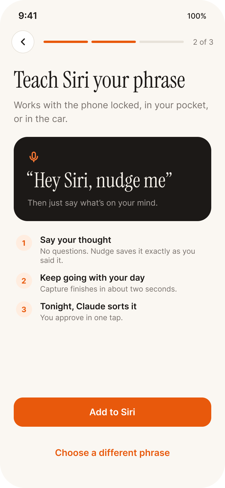<br>Siri phrase | 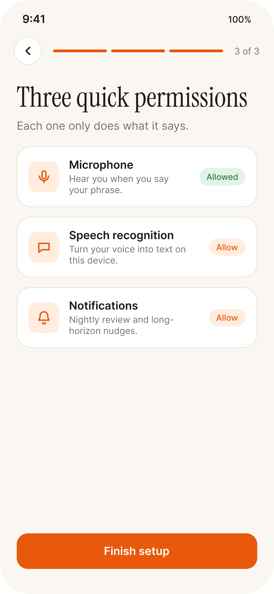<br>Permissions |
| 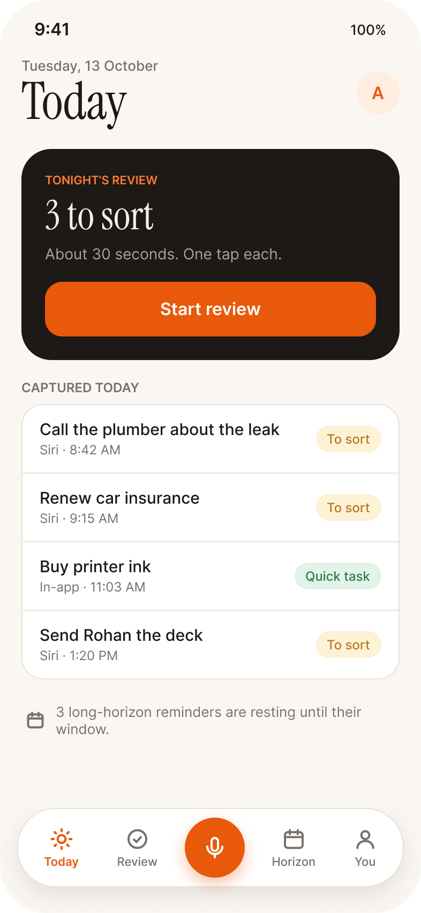<br>Today | 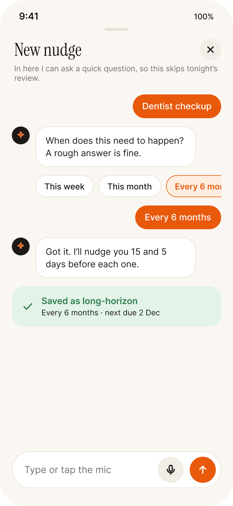<br>Capture (follow-up) | 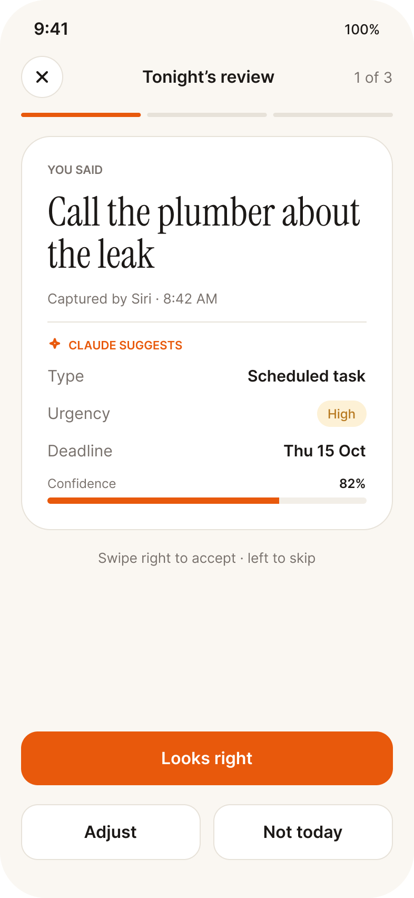<br>Nightly review | 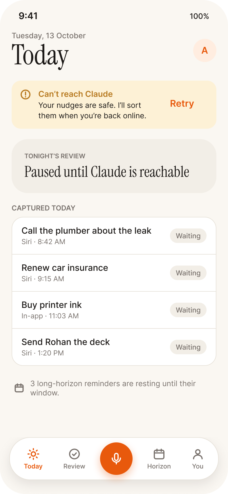<br>Today (provider unreachable) |
| 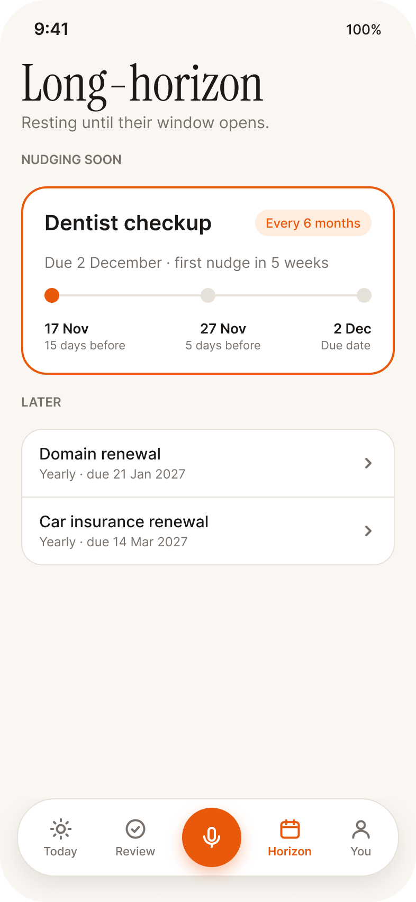<br>Long-horizon | 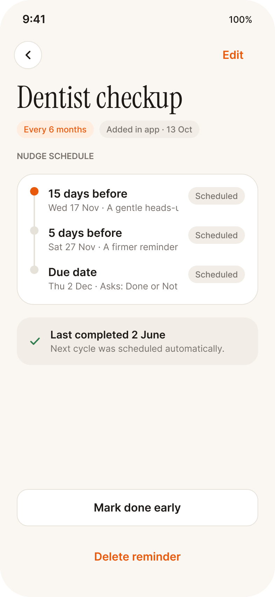<br>Reminder detail | 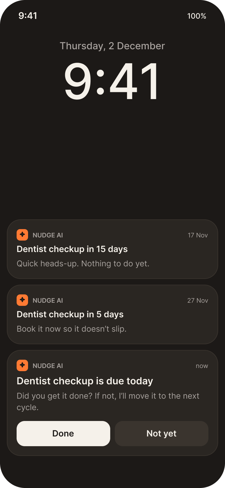<br>Escalating notifications | 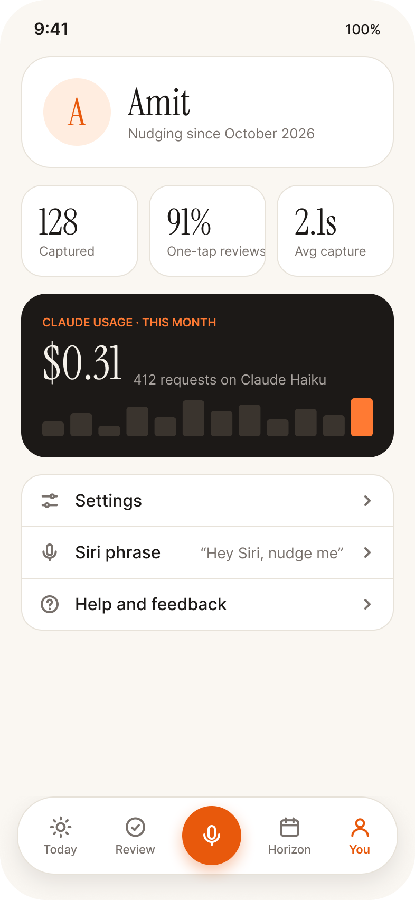<br>You (Profile) |
| 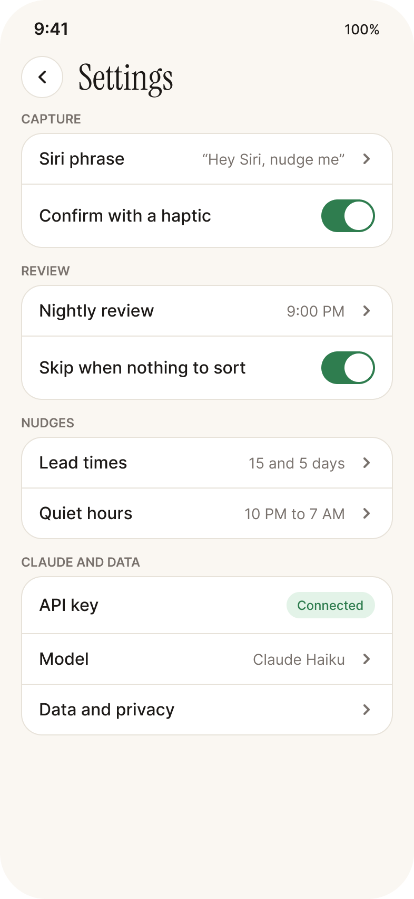<br>Settings | 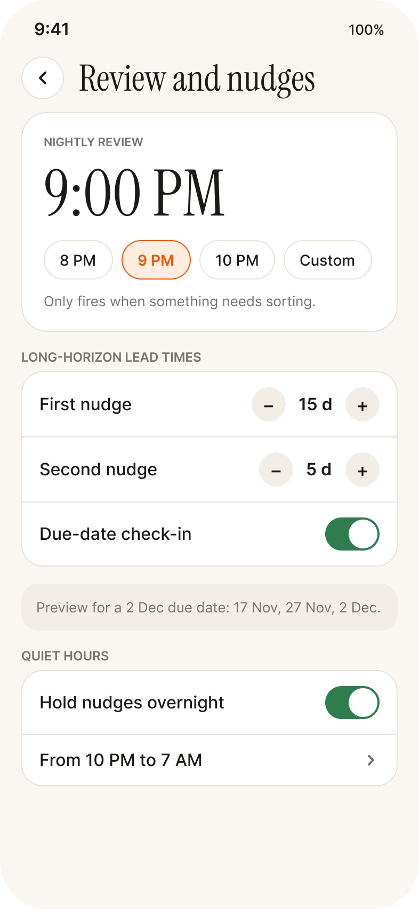<br>Review and nudge timing | 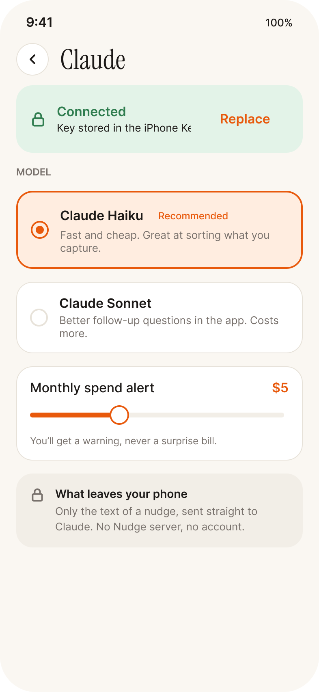<br>AI platform and privacy | 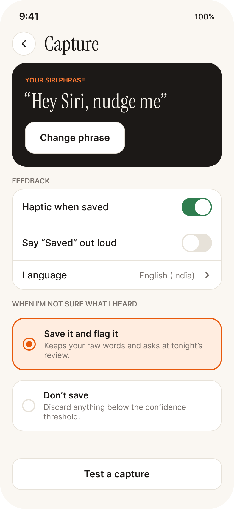<br>Capture settings |

## Docs

- [`References/NudgeAI_Spec.md`](References/NudgeAI_Spec.md): product spec
- [`References/design.md`](References/design.md): design tokens
- [`CLAUDE.md`](CLAUDE.md): how the app is built (rules, pipeline, structure)
